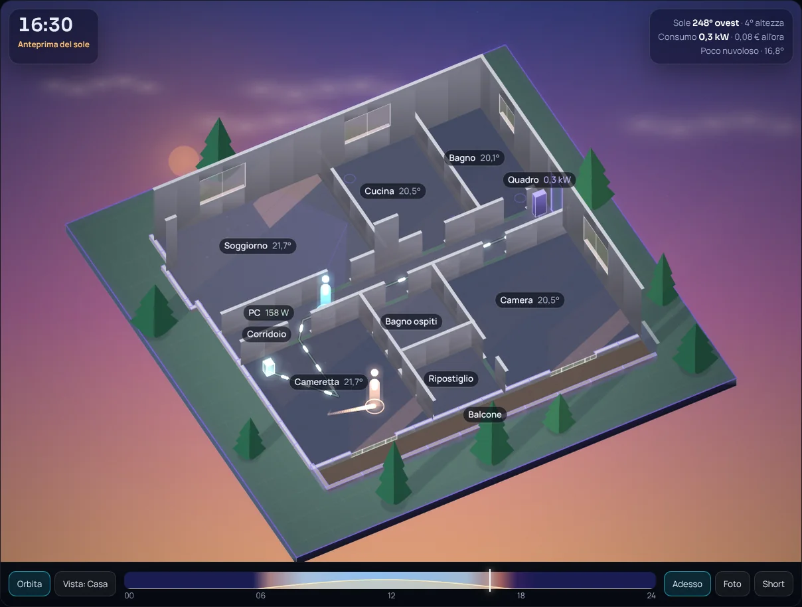
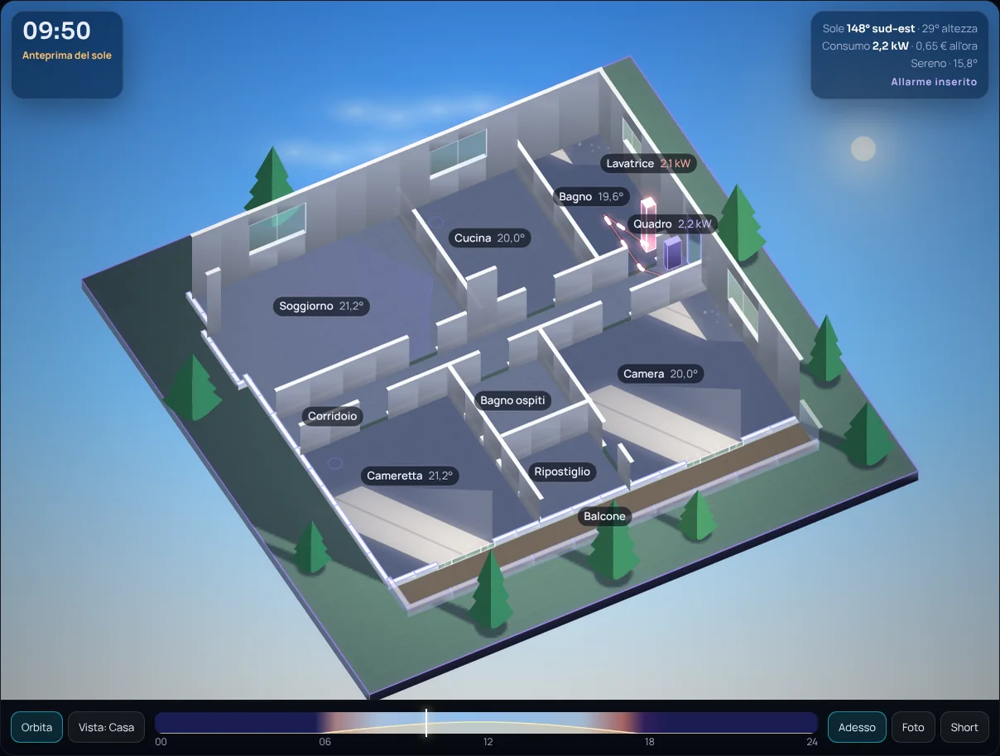
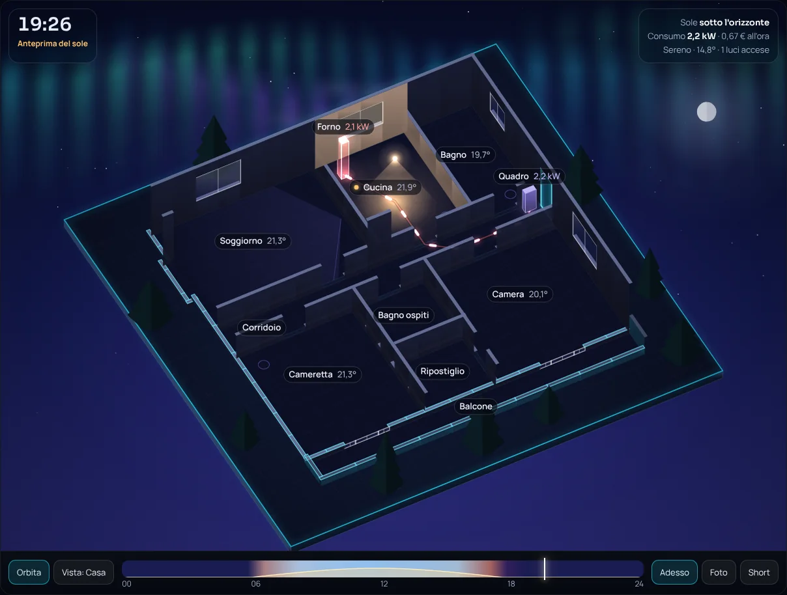
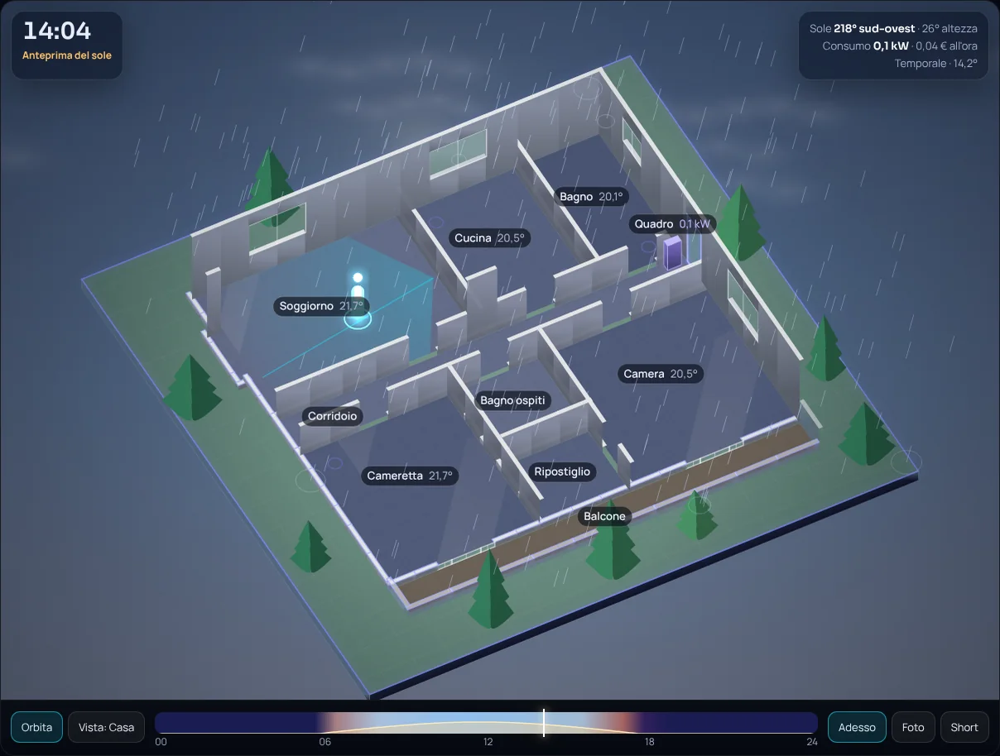

# Aurora Casa 3D

**La tua casa in 3D dentro Home Assistant, con le ombre del sole vere.** Una scheda per le plance: gira la casa con il dito, guarda il sole entrare dalle finestre all'ora giusta, le luci accendersi, le persone camminare come figure luminose e l'energia salire in colonne di luce.

[](https://my.home-assistant.io/redirect/hacs_repository/?owner=lucalux00&repository=aurora-casa-3d&category=plugin)
[](https://domotikpro.it/aurora-casa-3d-demo/index.html)
[](https://domotikpro.it/progetti/aurora-casa-3d)



> English: a Home Assistant dashboard card that shows your home in 3D with real sun shadows, lights, people and energy. It can **read the map you already drew for Aurora Casa Viva** from your dashboards (`casa_viva: auto`). Install from HACS (custom repository, category *Dashboard*). See [English notes](#english) below.

## Cosa fa

- **Sole vero.** Le ombre dei muri cadono sul giardino e i fasci di luce entrano dalle finestre giuste, lunghi quanto devono, all'ora giusta. La barra del sole mostra le ombre di tutta la giornata.
- **Luci e persone.** Ogni luce accesa ha il suo cono e il vetro che brilla. Con i sensori di movimento compaiono figure luminose che passeggiano; con un radar LD2450 la figura sta dove sta la persona e lascia una scia.
- **Energia.** Gli apparecchi di cui misuri la potenza diventano colonne di luce alte quanto i watt, collegate al quadro da cavi su cui corrono impulsi. Costo all'ora con la tua tariffa.
- **Meteo e cielo.** Pioggia, neve, nebbia, lampi, stelle, luna con la fase vera e, nelle notti serene, un'aurora boreale. Colori del cielo come in [Aurora Glass v3](https://domotikpro.it/progetti/aurora-glass-v3).
- **Foto e Short.** Un pulsante salva una foto, un altro registra un video verticale 1080×1920 con la casa che gira e il sole che attraversa la giornata.
- **Nessun cloud.** Un solo file JavaScript, canvas 2D, nessuna libreria. L'unica richiesta esterna sono i font Google (si toglie con `fonts: false`).

| Alba, mattina | Notte | Temporale |
|---|---|---|
|  |  |  |

## Installazione con HACS

1. In Home Assistant apri **HACS**, menu ⋮ in alto a destra → **Archivi digitali personalizzati** (*Custom repositories*).
2. Incolla `https://github.com/lucalux00/aurora-casa-3d`, come tipo scegli **Dashboard** e premi **Aggiungi**. (Oppure usa il pulsante «Aggiungi a HACS» qui sopra.)
3. Cerca **Aurora Casa 3D** in HACS, premi **Scarica** e ricarica la pagina del browser (`Ctrl`+`F5`).

HACS registra da solo la risorsa `/hacsfiles/aurora-casa-3d/aurora-casa-3d.js`. Se usi plance in YAML, aggiungila tu in `Impostazioni → Plance → Risorse` come *Modulo JavaScript*.

<details>
<summary>Installazione a mano, senza HACS</summary>

Scarica `dist/aurora-casa-3d.js`, mettilo in `config/www/aurora-casa-3d/` e aggiungi la risorsa `/local/aurora-casa-3d/aurora-casa-3d.js?v=1` come *Modulo JavaScript* (Impostazioni → Plance → ⋮ → Risorse; serve la modalità avanzata nel profilo). Il pacchetto completo, con le istruzioni, è sulla [pagina del progetto](https://domotikpro.it/progetti/aurora-casa-3d).
</details>

## Uso

### Hai già Aurora Casa Viva: tre righe

La scheda trova da sola la mappa [Aurora Casa Viva](https://domotikpro.it/progetti/aurora-casa-viva) che hai in una plancia e la rifà in 3D. Aggiungi una scheda **Manuale** e scrivi:

```yaml
type: custom:aurora-casa-3d
casa_viva: auto
```

La scheda cerca la prima scheda `custom:aurora-casa-viva` nella plancia principale e poi in tutte le altre (la lista delle plance la possono leggere solo gli amministratori; per gli altri utenti vale la plancia principale o quella che indichi). Stanze, finestre, porte, apparecchi, radar, sensori: tutto quello che hai già scritto per la 2D vale anche per la 3D. Se cambi la mappa 2D, la 3D si aggiorna al prossimo caricamento.

Se hai più mappe, o vuoi indicare dove cercare:

```yaml
type: custom:aurora-casa-3d
casa_viva:
  dashboard: casa        # il nome nell'indirizzo della plancia (/casa); "lovelace" è la plancia principale
  view: Mappa            # titolo o percorso della vista (facoltativo)
  index: 0               # quale scheda, se in quella vista ce n'è più di una (facoltativo)
```

Tutto quello che scrivi accanto vince su quello importato, per esempio:

```yaml
type: custom:aurora-casa-3d
casa_viva: auto
wall_height: 2.9
camera: { yaw: -35, pitch: 55, zoom: 1.1 }
rooms:
  soggiorno: { name: Salotto }
```

### Da zero

Disegna la pianta con l'[editor gratuito](https://domotikpro.it/aurora-casa-viva-editor/index.html) e nella scheda *Codice* scegli **Aurora Casa 3D**: ottieni la configurazione completa da incollare. Oppure, se hai una scheda Casa Viva, copia il suo codice e cambia la prima riga in `type: custom:aurora-casa-3d`.

### Estrarre la configurazione in un file

`tools/estrai-casa-viva.py` legge le tue plance (`.storage/lovelace*`, e i file YAML se c'è PyYAML) e scrive la configurazione 3D già pronta. Non serve per usare la scheda: ti serve se vuoi la mappa «congelata» in un file.

```bash
python3 tools/estrai-casa-viva.py /config --elenco     # le schede Casa Viva trovate
python3 tools/estrai-casa-viva.py /config -o casa-3d.yaml
```

## Opzioni

Oltre a quelle di Aurora Casa Viva (`rooms`, `openings`, `doors`, `door`, `devices`, `radars`, `panel`, `north`, `px_per_meter`, `tariff`, `weather`, `alarm`, `power_total`, `tap_action`, `thermal`):

| Opzione | Cosa fa |
|---|---|
| `casa_viva` | `auto`, il nome di una plancia, oppure `{ dashboard, view, index }`: prende la mappa da una scheda Aurora Casa Viva |
| `language` | `it`, `en` o `auto` (segue il browser) |
| `wall_height` | altezza dei muri in metri (2.7) |
| `inner_wall_height` | altezza dei muri interni nella vista (1.25): più bassi, così si vede dentro |
| `cut_height` | altezza dei muri che stanno davanti a chi guarda (0.2) |
| `wall_thickness` | spessore dei muri in metri (0.13) |
| `smooth_walls` | le pareti oblique ricalcate a gradini da pochi centimetri diventano rette: tolleranza in metri (0.12); `false` per lasciare le stanze come sono disegnate |
| `ground_margin` | margine del giardino attorno alla casa, in metri (2.1) |
| `trees`, `tree_count` | gli alberi del giardino |
| `aurora_sky` | `false` toglie l'aurora boreale delle notti serene |
| `camera` | `{ yaw: -28, pitch: 50, zoom: 1 }` vista iniziale |
| `auto_rotate`, `auto_rotate_speed` | `true` fa girare la casa da sola dopo 5 secondi senza tocchi (di serie sta ferma), 3.2 gradi al secondo |
| `intro` | `true` per l'apertura animata (di serie niente) |
| `remember_view` | `false` per non ricordare la vista in cui hai lasciato la casa (di serie la ricorda, in questo browser) |
| `motion_timeout` | minuti oltre i quali un sensore di movimento (`device_class: motion`) fermo su «acceso» non conta come persona (10; 0 = mai). I radar di presenza non hanno limite |
| `furniture`, `furniture_edit` | l'elenco dei mobili (vedi sotto); `furniture_edit: false` toglie il pulsante Arreda |
| `max_fps`, `quality` | limite dei fotogrammi al secondo (45) e dei pixel (0.75–1): per tablet a muro |
| `height` | altezza della scheda in pixel |
| `tap_action` | `toggle`: il tocco su una stanza accende o spegne la luce; `details` (predefinito): apre i dettagli |
| `short` | `{ title, subtitle, brand, seconds: 14, sweep: true }` per lo Short |
| `layers` | `{ energy: false }` toglie i cavi dell'energia |
| `fonts` | `false` per non caricare i font Google |

La scheda legge solo ciò che le indichi e non scrive niente in Home Assistant, a parte accendere e spegnere le luci quando tocchi una stanza (con `tap_action: toggle`).

## Arredi

Il pulsante **Arreda** sotto la casa apre l'elenco dei mobili: tocca una stanza, scegli un mobile e trascinalo dove vuoi. I pulsanti lo ruotano, lo allargano, lo accorciano, lo alzano, lo spostano di 5 cm e lo colorano. I mobili si salvano da soli nei dati del tuo utente di Home Assistant (li ritrovi su telefono e tablet); **Copia YAML** scrive l'elenco da incollare nella scheda e **Ripristina** torna a quello scritto nella configurazione.

```yaml
furniture:
  - type: sofa           # divano
    at: [312, 268]       # centro, nei pixel della pianta (come radar e apparecchi)
    size: [2.2, 0.95]    # larghezza e profondità in metri (facoltativo)
    rotate: 90           # gradi in senso orario; 0 = fronte verso il basso della pianta
    color: "#7B8DB8"     # facoltativo
```

Tipi: sofa (divano), armchair (poltrona), table (tavolo), table_round (tavolo tondo), chair (sedia), bed (letto), bed_single (letto singolo), wardrobe (armadio), kitchen (mobili cucina), fridge (frigo), tv, desk (scrivania), bookcase (libreria), dresser (cassettiera), nightstand (comodino), carpet (tappeto), plant (pianta), toilet (wc), sink (lavabo), shower (doccia), bathtub (vasca), washer (lavatrice), box (scatola). `kitchen` accetta anche `upper: true` per i pensili.

## Stato e limiti

Versione 1.3, pensata per le plance a sezioni e a viste normali. È stata collaudata con la casa di prova dell'anteprima in Chrome (anche con schermo da smartphone) e il 26 ottobre 2026 su un Home Assistant 2026.9.1 vero, con la mappa Aurora Casa Viva letta da sola e i sensori reali. Anche Arreda (mobili aggiunti, spostati, salvati e ritrovati dopo il ricaricamento) e i sensori di movimento fermi su «acceso» sono stati provati lì. Non ancora provate: plance in YAML, utenti non amministratori e tablet a muro. In una plancia a sezioni la scheda riempie la sua sezione: per averla larga come la pagina scrivi nella sezione `column_span: 2` (o 3). Se la provi sulla tua installazione e qualcosa non va, apri una [segnalazione](../../issues) con la versione di Home Assistant e il browser. Le ombre sono calcolate dal sole (precisione di circa mezzo grado) e dai muri che disegni: non conoscono i palazzi o gli alberi veri attorno alla tua casa. Lo Short usa la registrazione del browser (MediaRecorder), non disponibile in tutte le app.

## Licenza

Uso personale gratuito, vedi [LICENSE](LICENSE). Installare la scheda da questo repository o da HACS è l'uso previsto. © 2026 DomotikPro.it (Luca Pinelli).

---

## English

**Aurora Casa 3D** is a Home Assistant dashboard card that renders your home in 3D (canvas 2D, a single JavaScript file, no libraries, no cloud): real sun position drives wall shadows and the light beams entering through your windows, lights have cones, people appear as glowing figures (motion sensors or LD2450 radar), power draw becomes columns of light fed from your fuse box, and the sky, weather and an aurora follow the real conditions. It can record a vertical 1080×1920 Short.

**Install:** HACS → ⋮ → *Custom repositories* → add `https://github.com/lucalux00/aurora-casa-3d` as category **Dashboard** → download Aurora Casa 3D → hard-reload the browser.

**Use it with a map you already have.** If you use [Aurora Casa Viva](https://domotikpro.it/progetti/aurora-casa-viva), add a Manual card:

```yaml
type: custom:aurora-casa-3d
casa_viva: auto
language: en
```

The card looks for the first `custom:aurora-casa-viva` card in your main dashboard and then in the others (listing dashboards needs an admin user), and renders it in 3D. Anything you write next to `casa_viva` overrides the imported config. Without Casa Viva, draw your floor plan with the [free editor](https://domotikpro.it/aurora-casa-viva-editor/index.html) and pick *Aurora Casa 3D* in its Code tab.

The **Furnish** button lets you drop a sofa, table, bed or kitchen units on the floor and drag them around; the layout is saved in your Home Assistant user data (`furniture:` in the card YAML works too). By default the house stays where you leave it (`auto_rotate: true` to spin it), and a motion sensor stuck on for more than 10 minutes (`motion_timeout`) is ignored.

`tools/estrai-casa-viva.py` can also export your Casa Viva configuration from `.storage` into a file. Options are listed in the table above. Status: version 1.3, tested with the demo house in Chrome and, on 26 October 2026, on a real Home Assistant 2026.9.1 with the Casa Viva map read automatically and live sensors. The furnishing mode (add, drag, save and reload) and stuck motion sensors were tested there too. Not yet tested: YAML-mode dashboards, non-admin users, wall tablets. In a sections dashboard the card fills its section: set `column_span: 2` (or 3) on the section for full page width. Please open an issue if something breaks on your setup. Personal, non-commercial use, see [LICENSE](LICENSE).
